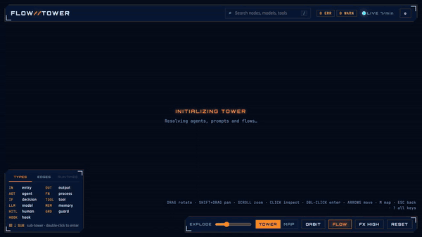
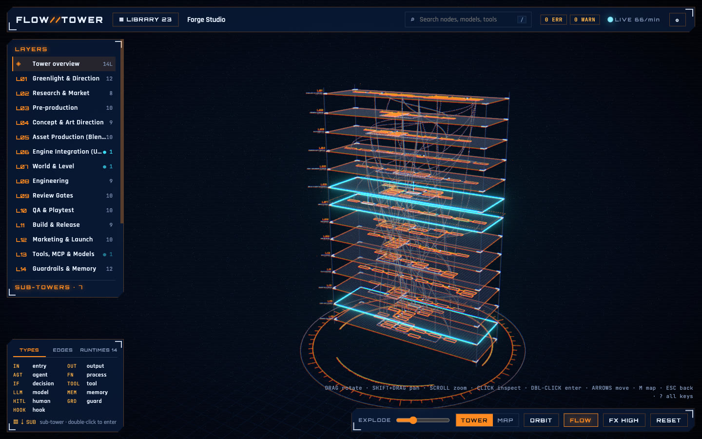
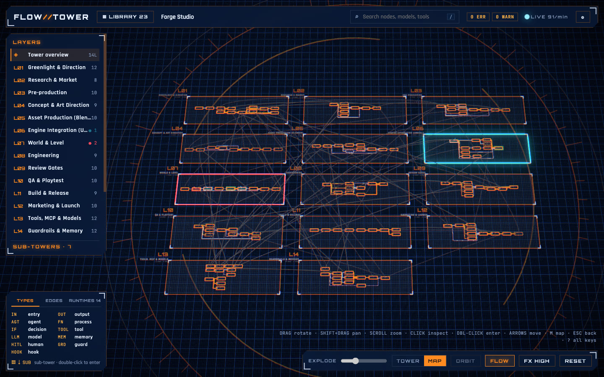
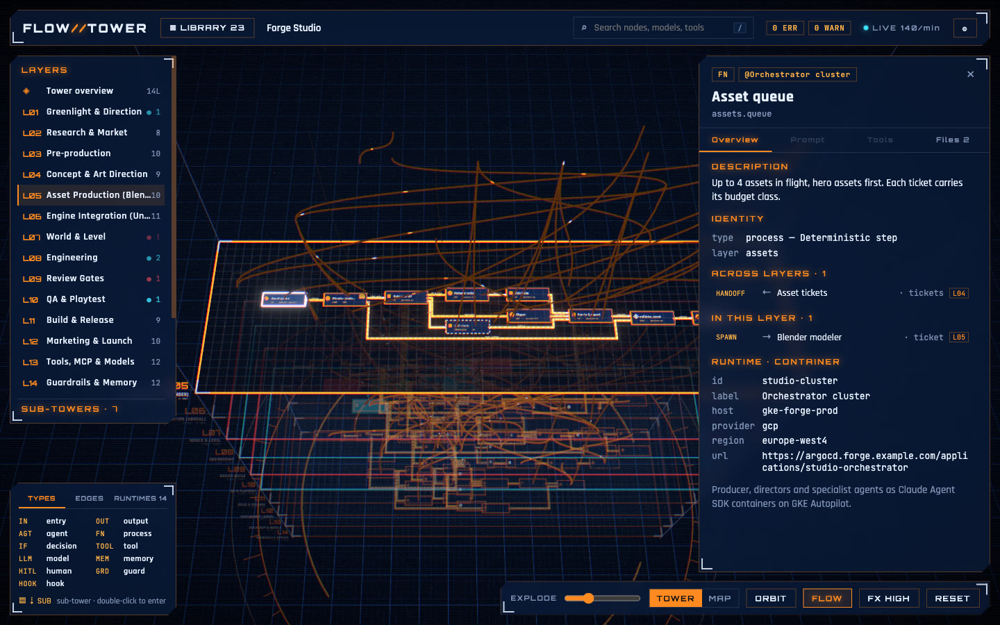
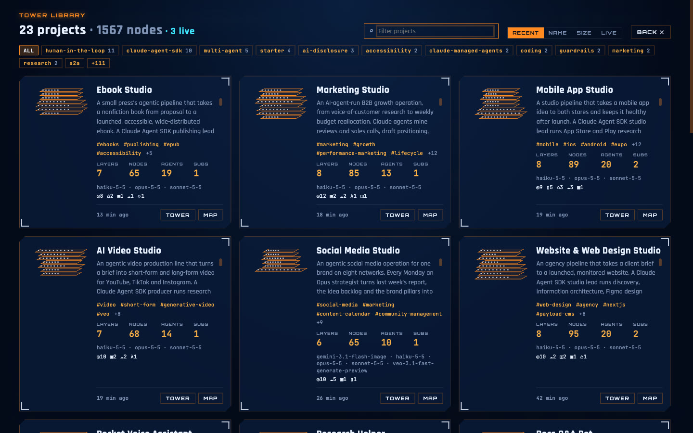

# Flow Tower

**See the whole structure of an agentic system at once.** Flow Tower renders AI agents and multi-agent systems as an interactive 3D tower. Each layer is a left-to-right flowchart. Click any node to open its system prompt, tools, model, harness settings, files, logs and the services it runs on.



<sub>Full video (27 s, higher quality): [docs/demo.mp4](docs/demo.mp4). Recorded with the live simulator running.</sub>

**[Try the live demo →](https://jamesmoriartydecripto.github.io/flow-tower/)** Every example project in your browser, with simulated live events. Nothing to install. Press `?` for the keyboard shortcuts.

- **One YAML file per system.** It is easy to write and review, and it lives in the same repo as the agent.
- **Tower of layers.** Stack layers like intake, orchestration, specialists, tools, guardrails, memory and models. Cross-layer links show who calls whom.
- **Nested towers.** An agent can contain its own tower. Double-click it to dive in, as deep as you need.
- **Real files.** Prompts, code, configs and logs open in a syntax-highlighted viewer; Markdown is formatted, with math in `$$…$$` rendered by KaTeX; SQLite databases and `.sql` schemas open as tables. Existing Claude Code agents (`.claude/agents/*.md`) import as they are.
- **Hybrid deployments.** `runtimes` show what runs on a laptop, a server, a CI job or a third-party service.
- **Structural changes.** Mark nodes `planned`, `experimental` or `deprecated`.
- **How it runs in production.** Triggers, human approvals with timeouts, budgets, limits, fan-out, data sensitivity, evals, rollouts and SLAs show on the nodes and in the node panel.
- **Library.** Point it at a folder and browse every project you work on. Switch between a stacked tower and a top-down map.
- **Keyboard first.** Arrows walk nodes and layers, Enter dives into sub-towers or the node panel, `?` lists every shortcut. Settings cover themes, fonts, interface size and animations.
- **Voice.** Press V and talk to the tower, in Italian, English or any language: "open dev squad", "explain the flow of the first layer", "show me this node's files", "spiegami questo file". It answers out loud and shows what it talks about; "guided tour" / "panoramica guidata" walks you through every layer and node ([details](docs/voice.md)).
- **Node list.** Focus a layer and its nodes are listed on the right in flow order, readable however far the cards are.
- **Tower card.** At Tower overview the right panel shows the tower's own card, as in the library: description, tags, layers, nodes, agents, sub-towers, models, runtimes, errors and live usage. Inside a sub-tower it is that sub-tower's card; `–` reduces it to its title, and the choice is remembered.
- **Live.** Save the YAML, or any referenced file, and the tower updates.
- **Generate towers with any coding agent.** Claude Code, Codex, Pi, Hermes, Cursor or any other agent reads an agentic codebase and writes a validated tower. It maps Claude Code, the Agent SDK, LangGraph, CrewAI, OpenAI Agents, Pi, Hermes and more.
- **Realtime agents.** Connect Claude Code, the Agent SDK, Codex, Pi, Hermes or your own loops. Active nodes light up, errors flash, and a live feed shows every step. See [docs/realtime.md](docs/realtime.md).

| Tower | Map |
|---|---|
|  |  |
| **Node panel** | **Library** |
|  |  |

## Quick start

Requires Node 22.13 or newer. The app runs locally on `127.0.0.1`. Nothing is uploaded.

```bash
git clone https://github.com/JamesMoriartyDecripto/flow-tower.git
cd flow-tower && npm install
```

1. **Copy one tower and use it.** Copy an example folder into your project and open it:
   `cp -R examples/starters/single-agent ~/my-project/tower && node bin/flow-tower.js ~/my-project/tower`.
   `npm run dev` opens the whole examples gallery (`npm run dev -- --port 5318` when 5317 is taken).
   The CLI is `node bin/flow-tower.js`; `npm link` makes it a plain `flow-tower` command (the CLI's hints print whichever works on your machine).
2. **Your own towers**, from scratch or generated from your code: [docs/getting-started.md](docs/getting-started.md).
3. **A command center** on a VPS or server that your machines report to: [docs/command-center.md](docs/command-center.md).

```bash
node bin/flow-tower.js ~/projects            # every *.tower.yaml found, as a library
node bin/flow-tower.js init my-agent.tower.yaml   # starter file
node bin/flow-tower.js other.tower.yaml --port 5318  # a second server next to the first
node bin/flow-tower.js my.tower.yaml --browser firefox   # another browser (or set $BROWSER)
```

## A tower in 30 lines

```yaml
# yaml-language-server: $schema=./schema/flow-tower.schema.json
name: Research Agent
runtimes:
  laptop: { kind: local }
  search: { kind: saas, provider: brave }
prompts:
  main: { file: prompts/main.md }
agents:
  lead: { model: claude-opus-5-5, prompt: main, tools: [web_search], runtime: laptop }
  critic: { from: .claude/agents/critic.md }
layers:
  - id: loop
    title: Agent Loop
    nodes:
      - { id: ask, type: entry, label: User question }
      - { id: lead, agent: lead }
      - { id: review, agent: critic }
      - { id: ok, type: decision, label: Good enough? }
      - { id: answer, type: output, label: Answer }
    edges:
      - ask -> lead
      - lead -> review [handoff]
      - review -> ok
      - "ok -> lead [return]: no, max 3"
      - "ok -> answer: yes"
  - id: tools
    title: Tools
    nodes:
      - { id: web_search, type: tool, label: Web search, runtime: search }
links:
  - loop.lead -> tools.web_search [call]
```

See the full **[schema reference](docs/schema.md)**, and **[what goes where](docs/what-goes-where.md)** for what belongs in layers, nodes, edges and nested towers. A generated JSON Schema (`schema/flow-tower.schema.json`) gives autocomplete in VS Code.

## Examples

Start small with a **starter** (one short YAML file), or open a preset close to your system. The full index, by pattern, is in **[examples/README.md](examples/README.md)**.

| Starters | Layers |
|---|---|
| [`single-agent`](examples/starters/single-agent): one agent in a tool loop | 1 |
| [`rag-bot`](examples/starters/rag-bot): nightly ingestion + cited Q&A | 2 |
| [`pr-reviewer`](examples/starters/pr-reviewer): GitHub Actions PR review with approval | 3 |
| [`voice-assistant`](examples/starters/voice-assistant): on-device voice around Claude | 3 |

**Presets**: software delivery ([`dev-squad`](examples/dev-squad)), game studio ([`game-studio`](examples/game-studio)), courses ([`course-studio`](examples/course-studio)), websites ([`web-studio`](examples/web-studio)), SRE ([`sre-incident`](examples/sre-incident)), fraud review ([`fraud-desk`](examples/fraud-desk)), deep research ([`deep-research`](examples/deep-research)), AI co-scientist ([`co-scientist`](examples/co-scientist)), customer service ([`airline-support`](examples/airline-support)), chief of staff ([`chief-of-staff`](examples/chief-of-staff)), browser automation ([`browser-worker`](examples/browser-worker)), A2A commerce ([`a2a-concierge`](examples/a2a-concierge)), legal due diligence ([`legal-diligence`](examples/legal-diligence)), Jev decision layer ([`jev-agent`](examples/jev-agent)), social media ([`social-studio`](examples/social-studio)), AI video ([`ai-video-studio`](examples/ai-video-studio)), ebooks ([`ebook-studio`](examples/ebook-studio)), mobile apps ([`mobile-studio`](examples/mobile-studio)), marketing ([`marketing-studio`](examples/marketing-studio)), B2B sales to invoice ([`sales-pipeline`](examples/sales-pipeline)), Italian e-invoicing with Fatture in Cloud ([`invoicing-fic`](examples/invoicing-fic)).

Every example ships real prompt, agent, code, config and log files, so the popups have something to show, and a README with its sources.

## Generate a tower from your code (any coding agent)

Your coding agent reads the codebase and writes the tower. The procedure is harness-neutral: [docs/generate-a-tower.md](docs/generate-a-tower.md). Install it as an [Agent Skill](https://agentskills.io) for your agent (further skills: [flow-tower-costs](skills/flow-tower-costs/SKILL.md) uses the tower to cut model cost and latency with benchmarks on real cases, [flow-tower-report](skills/flow-tower-report/SKILL.md) makes professional PDF reports from your sources, [flow-tower-optimize](skills/flow-tower-optimize/SKILL.md) audits a tower against [best practices](docs/best-practices.md) and proposes changes, [flow-tower-my-library](skills/flow-tower-my-library/SKILL.md) keeps your own towers in one library, [flow-tower-command-center](skills/flow-tower-command-center/SKILL.md) sets up the shared hub, [flow-tower-satellite](skills/flow-tower-satellite/SKILL.md) connects a machine to it):

```bash
node bin/flow-tower.js install-skill                  # Claude Code: ~/.claude/skills
node bin/flow-tower.js install-skill --target codex   # Codex: ~/.agents/skills
node bin/flow-tower.js install-skill --target pi      # Pi: ~/.pi/agent/skills
node bin/flow-tower.js install-skill --target hermes  # Hermes Agent: ~/.hermes/skills
node bin/flow-tower.js install-skill --target cursor  # Cursor: ~/.cursor/skills
node bin/flow-tower.js install-skill --target agents  # shared ~/.agents/skills (Agent Skills clients)
# add --project to install into the current project instead (e.g. ./.claude/skills)
```

Then ask your agent, inside any agent project: *"map this agent system into a flow tower"*. Any other agent works too: tell it to run `node <flow-tower>/bin/flow-tower.js guide` and follow the printed procedure. Agents that clone this repo find the same pointer in [AGENTS.md](AGENTS.md). The procedure:
1. inventories agents, prompts, tools/MCP, hooks, memory, models, runtimes and logs, from the code only;
2. writes `<system>.tower.yaml`, plus nested towers when needed;
3. runs `flow-tower validate` until there are no errors or warnings.

Run it again later to update the tower, or to mark parts as deprecated or planned.

```bash
node bin/flow-tower.js validate path/to/agent.tower.yaml [--json]   # also great in CI
```

## Live events

```bash
npm run simulate -- game-studio        # see it without wiring anything
```

`flow-tower hooks install` wires Claude Code, Codex, Pi and Hermes in one step. The Agent SDK, your own scripts, and tokens and cost per node (OpenTelemetry): [docs/realtime.md](docs/realtime.md). Events from other machines go to a shared hub: [docs/command-center.md](docs/command-center.md).

## Controls

| Input | Action |
|---|---|
| Drag | Rotate |
| Right-drag, **Shift + drag**, **Shift + two-finger scroll** (trackpad) | Pan |
| Scroll, pinch | Zoom |
| Hover a layer | Lens: magnify it and spread the stack around it |
| Click node | Inspect it and highlight its upstream and downstream paths; the camera centers it and moves in close |
| Double-click node, **Enter**, or ⇣ in the Sub-towers list | Enter its sub-tower (marked by stacked plates and `⇣ SUB`) |
| **1–9**, **0** | Focus a layer / overview |
| **Esc**, **Backspace** | Go back (file, then selection, then layer, then parent tower) |
| **/** | Search nodes, models, tools |
| **L** | Project library |
| **M** | Switch Tower / Map view (map: layers side by side, seen from above); the choice also applies to sub-towers |
| **,** | Settings: theme, interface size and fonts, performance, effects, views, live behaviour |
| **← → ↑ ↓** | Move to the nearest node; ↑ ↓ cross to the layer above / below (library: move between cards) |
| **PgUp / PgDn** | Previous / next layer |
| **Shift / Alt + arrows**, **+ / −** | Orbit / pan / zoom the camera |
| **[ ]** | Previous / next tab of the selected node |
| **F**, **O** | Live feed, auto-orbit |
| **V** | Voice commands: start / stop listening (also in the library); see [docs/voice.md](docs/voice.md) |
| **P**, **X** | Download a ZIP of every layer and the map of the project and its sub-towers: Full HD PNGs (plus the 3D view), or editable SVGs |
| **D** | Documentation as PDF: the menu picks one of the four levels (below) for the root project |
| **?** | Every keyboard shortcut |

Everything works without a mouse: **Tab** moves between HUD buttons, **Enter / Space** press them.

The bottom bar toggles orbit, flow particles and the rendering quality (`eco` / `balanced` / `high`), and has the PNG / SVG export buttons. You can also force a preset with `?quality=eco`.

### Documentation as PDF

The PDF menu (**D**, or the PDF button) prints the document in a new tab. Four levels:

| Level | What it prints |
|---|---|
| 1 Images | One page per layer: the drawing |
| 2 Overview | Cover, document control, summary, and a table of the layers and nodes |
| 3 Full documentation | Level 2 plus a sheet for every node, nested towers, findings and sources |
| 4 Library | Several projects in one file: a library cover, a contents list, then each project at level 2. Shown when the workspace has more than one project; `?doc=library&level=4&projects=a,b` names the projects (all of them when omitted) |

From the command line, `flow-tower export <tower file | dir> --pdf [--level 1|2|3|4] [--out file.pdf]` writes the PDF. Before writing it, the export runs blocking checks (every layer, node and sub-tower is printed, the counts match the workspace, every link has a target, no raw JSON); a failed check prints what it found and writes no file. Level 4 needs a directory and runs the same checks for each project. The 3D figures use the GPU when the browser gets one and fall back to software WebGL otherwise (it prints which: `3D: GPU (...)` or `3D: software (SwiftShader)`); `FLOW_TOWER_GL=gpu` or `FLOW_TOWER_GL=software` forces the choice.

Links can open a tower, a layer or a node directly: `?tower=request` (the id, the file name without `.tower.yaml`, or the name), `&layer=security` (focuses the layer), `&node=handle.problem` (selects the node). Handy for sharing and for screenshots.

## Voice

Press **V** and talk to the tower; it answers out loud. Setup (an OpenRouter key), commands, the voice agent, privacy and where your data lives: [docs/voice.md](docs/voice.md).

## Performance

Flow Tower is meant to run next to busy agents, so it is frugal by design:

- **On-demand rendering.** Nothing is drawn unless something changed: camera, transitions, live events. In `eco` an idle tower costs **0 frames per second**.
- **FPS budget per preset:**

  | Preset | Cap | Post-processing |
  |---|---|---|
  | `eco` | 20 fps | none |
  | `balanced` (default) | 30 fps | light bloom |
  | `high` | 60 fps | full effects |

  The **FX** button cycles through them, or force one with `?quality=eco`.
- **Background.** When the window is not focused the canvas drops to 10 fps and stops decorative motion.
- **Batched scene.** Each layer is drawn with a handful of draw calls (instanced meshes, batched lines, troika `BatchedText`). Labels you could not read at the current zoom are skipped.

## Privacy and updates

Flow Tower runs on your machine: the server listens on `127.0.0.1` only, reads only inside your projects, and live events never leave your computer. It calls out in two cases only. **Voice** sends speech clips, questions and, if you turn learning on, journal reviews to OpenRouter with zero data retention, only when you use it and have set a key ([details](docs/voice.md)). Your key, journal and voice memory stay in `~/.config/flow-tower` ([where your data lives](docs/voice.md#where-your-data-lives)). The **update check** runs once a day: it asks GitHub for the latest release (`api.github.com/repos/JamesMoriartyDecripto/flow-tower/releases/latest`, nothing about you or your towers is sent). When a newer version exists, the terminal prints how to update and the top bar shows a small `↑ vX.Y.Z` link to the release notes. Turn it off with `--no-update-check` or `FLOW_TOWER_NO_UPDATE_CHECK=1`; it is always off in CI and in the online demo. The update steps (Settings › Updates and the copyable command) live in [docs/getting-started.md § Updating](docs/getting-started.md#updating).

## Project layout

```
bin/            CLI: serve, init, validate, library, emit, guide, install-skill
src/core/       schema (zod), YAML loader, validation, live-event adapters and matching
src/server/     Vite plugin: /api/workspace, /api/file (read-only, sandboxed), /api/events, /api/voice (speech, agent, spoken replies, journal), live reload
src/app/        React + three.js app: scene/ (3D) and hud/ (overlay UI)
src/cli/        TypeScript CLI commands (validate, library)
schema/         generated JSON Schema
skills/         Agent Skills: flow-tower (generates towers from a codebase), flow-tower-costs (model cost/latency), flow-tower-report (PDF reports), flow-tower-optimize (audit and improve a tower), flow-tower-my-library (keep your own towers in one library), flow-tower-command-center (set up the shared hub), flow-tower-satellite (connect a machine to the hub)
integrations/   live-event configs for Claude Code, Agent SDK, Codex, Pi, Hermes
examples/       starters (1–3 layers) and researched presets, indexed by pattern in examples/README.md
scripts/        schema, stress-tower and event-simulator scripts
docs/           getting started, command center, schema, architecture, realtime, voice, tower generation
```

## Contributing

See [CONTRIBUTING.md](CONTRIBUTING.md), [CODE_OF_CONDUCT.md](CODE_OF_CONDUCT.md) and [SUPPORT.md](SUPPORT.md). To add your tower to the examples gallery, the [contribute skill](skills/flow-tower-contribute/SKILL.md) anonymises it, runs `flow-tower check-example <dir>` and opens the PR. Please report security issues privately ([SECURITY.md](SECURITY.md)).

## License

[MIT](LICENSE)
